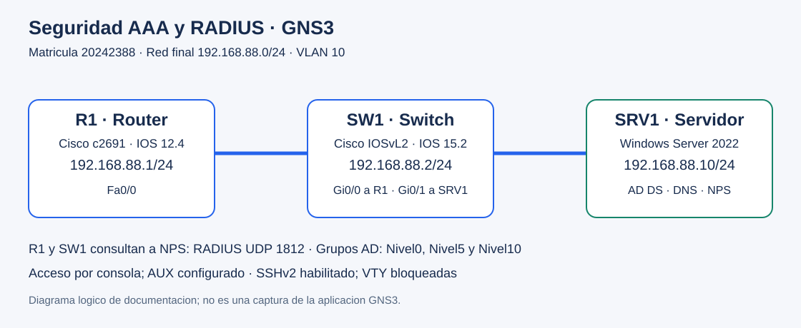
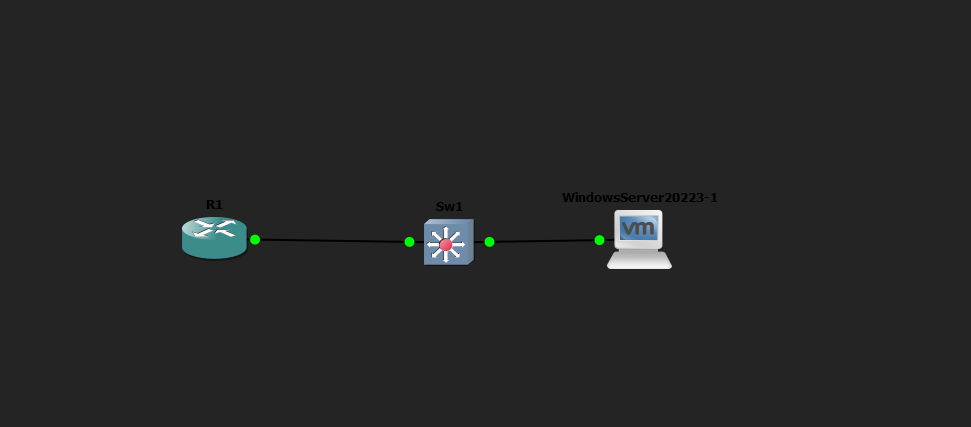
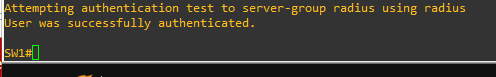
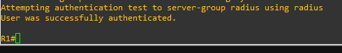

> **Video demostrativo en YouTube: PENDIENTE DE GRABAR Y ENLAZAR.** Duracion maxima: 10 minutos. La entrega no esta completa hasta agregar el enlace aqui y al TXT final.

# Seguridad de acceso con AAA, RADIUS y Active Directory

**Autor:** Axel Enrique Vasquez Peña · **Matricula:** 20242388 · **Plataforma:** GNS3 · **Dominio:** seguridad.test

## Proposito

Centralizar la autenticacion de un router y un switch Cisco mediante Windows Server 2022, Active Directory y Network Policy Server (NPS). Aplicar niveles de privilegio 0, 5 y 10, restringir comandos y comprobar el acceso local de respaldo cuando RADIUS no responde. La infraestructura completa se documenta en este unico repositorio.

## Captura real en GNS3

El nodo WindowsServer20223-1 de GNS3 corresponde a SRV1 dentro de Windows. Los indicadores verdes muestran enlaces activos; la captura no muestra las direcciones IP.

## Infraestructura y direccionamiento

La red final **192.168.88.0/24** utiliza el valor 88 de los ultimos dos digitos de la matricula 20242388. Este es el criterio adoptado para el laboratorio.

| Equipo | Software | Interfaz | IP |
|---|---|---|---|
| R1 | Cisco c2691, IOS 12.4(25d) ADVSECURITYK9 | FastEthernet0/0 | 192.168.88.1/24 |
| SW1 | Cisco IOSvL2, IOS 15.2 | Vlan10 | 192.168.88.2/24 |
| SRV1 | Windows Server 2022; AD DS, DNS y NPS | Ethernet0 2 | 192.168.88.10/24 |

R1 Fa0/0 conecta con SW1 Gi0/0; SRV1 conecta con SW1 Gi0/1. Ambos puertos del switch pertenecen a VLAN 10 (ADMINISTRACION). SW1 y SRV1 usan 192.168.88.1 como puerta de enlace. El DNS de SRV1 apunta a 192.168.88.10.

## Autenticacion y autorizacion

1. El usuario inicia sesion por consola (auxiliar tambien tiene las listas configuradas).
2. El equipo consulta a NPS por RADIUS UDP 1812 usando su IP de administracion como origen.
3. NPS valida el usuario de Active Directory y selecciona la politica del grupo.
4. Devuelve Service-Type Login y Cisco-AV-Pair `shell:priv-lvl=N`.
5. IOS autoriza la sesion EXEC y controla los comandos mediante niveles de privilegio locales.

| Usuario | Grupo AD | Politica NPS | Nivel | Permitido en las pruebas | Bloqueado en las pruebas |
|---|---|---|---|---|---|
| usuario0 | Nivel0 | Cisco-Nivel0 | 0 | show privilege | ping, show interfaces |
| usuario5 | Nivel5 | Cisco-Nivel5 | 5 | ping | show interfaces |
| usuario10 | Nivel10 | Cisco-Nivel10 | 10 | show interfaces | configure terminal |
| adminlocal | Cuenta local en cada equipo | Respaldo local | 15 | Administracion cuando NPS no responde | No aplica |

Esta tabla describe los comandos probados, no una lista exhaustiva de todos los comandos de IOS. No se implemento autorizacion RADIUS por comando: NPS asigna el nivel y el dispositivo aplica las restricciones. Una respuesta Access-Reject no activa el respaldo local; se utiliza cuando RADIUS no responde. La clave de `enable` es exclusiva del administrador: conocerla permite elevar privilegios.

## Acceso y registros

- Consola y auxiliar: autenticacion y autorizacion EXEC mediante CONSOLA_RADIUS.
- VTY: `transport input none`; las conexiones remotas estan bloqueadas.
- SSHv2: servicio configurado y verificado con `show ip ssh`; no se afirma una conexion SSH remota exitosa.
- HTTP y HTTPS de administracion: deshabilitados.
- Accesos: `login on-success log` y `login on-failure log`.
- AAA y RADIUS: depuracion temporal capturada y apagada con `undebug all`.
- NPS: eventos 6272 (concesion) y 6273 (rechazo).

Los registros del bufer IOS son volatiles; no se configuro un servidor syslog externo. Las pruebas de acceso fueron por consola; AUX esta configurado, pero no se realizo una prueba fisica de AUX. El puerto 1813 esta definido, pero no se configuro AAA accounting de sesiones.

## Documentacion y archivos

- [Procedimiento de configuracion](docs/configuracion.md)
- [Pruebas, capturas y alcance de las evidencias](docs/pruebas.md)
- [Direccionamiento y migracion](docs/direccionamiento.md)
- [Guion de demostracion y pendientes de entrega](docs/entrega.md)
- [Running-config R1, sin credenciales](configs/R1-running-config.txt)
- [Running-config SW1, sin credenciales](configs/SW1-running-config.txt)
- [VLAN del switch](configs/SW1-vlans.txt)
- [Comandos y scripts](scripts/README.md)

## Evidencia posterior al cambio de IP

El operador aporto las siguientes respuestas exitosas despues de actualizar las IP de los equipos, los clientes NPS y el enlace del servicio IAS:

Las capturas de privilegios y respaldo de la [galeria](docs/pruebas.md) pertenecen a la etapa anterior con 192.168.50.0/24. Son evidencia historica del proceso y deben complementarse con pruebas finales en 192.168.88.0/24 para el video.

## Proteccion de credenciales y limites

Las configuraciones publicas contienen `[OCULTO]` en lugar de claves y hashes; son copias de documentacion y requieren completar los secretos antes de importarlas. El XML privado de NPS, archivos de autenticacion de GitHub y claves privadas no forman parte del repositorio. La copia publica de NPS todavia no fue aportada para revision.

RADIUS clasico con PAP se utilizo en esta red aislada. No cifra todo el trafico entre los equipos y el servidor. `service password-encryption` no ofrece proteccion criptografica fuerte para claves tipo 7. Estas decisiones y las versiones antiguas de IOS son limites del laboratorio, no un modelo listo para produccion.

## Estado de la entrega

Configuracion y pruebas documentadas a partir de las salidas y capturas del operador. Pendientes: video real con cara y voz, identificador P# confirmado, TXT final, XML NPS publico revisado y capturas finales adicionales. No se incluyen evidencias simuladas ni se afirman pruebas no realizadas.
