# Pruebas y evidencias

## Alcance temporal

Las capturas son originales aportados por el operador, sin alterar su contenido. Las de privilegios, eventos y respaldo se tomaron antes de migrar desde 192.168.50.0/24. Los running-config publicos representan 192.168.88.0/24. Tras la migracion se aportaron respuestas exitosas de test aaa en ambos equipos y se confirmo verbalmente conectividad y DNS. Las capturas no sustituyen una demostracion final con las IP actuales.

## Topologia real


## Autenticacion despues de la migracion

Estas capturas muestran la respuesta del test de autenticacion. Por si solas no muestran el usuario, la IP consultada ni el nivel de una sesion interactiva; se complementan con las configuraciones y las pruebas de consola.


## Privilegios R1: evidencia historica

Nivel 0: show privilege permitido; ping y show interfaces bloqueados.

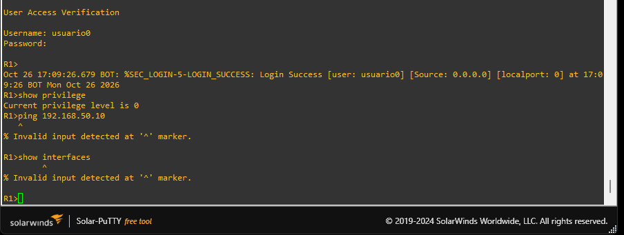

Nivel 5: ping exitoso; show interfaces bloqueado.

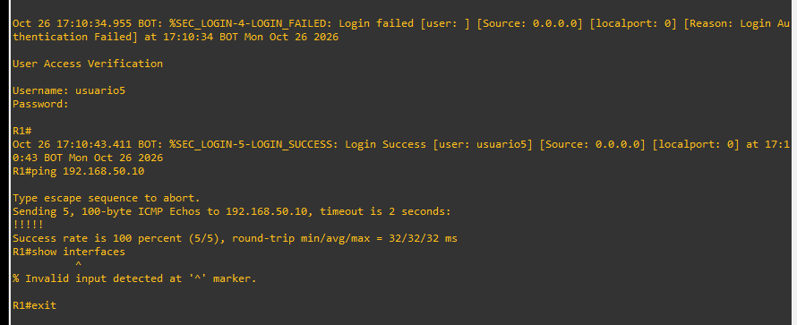

Nivel 10: show interfaces permitido; configure terminal bloqueado.

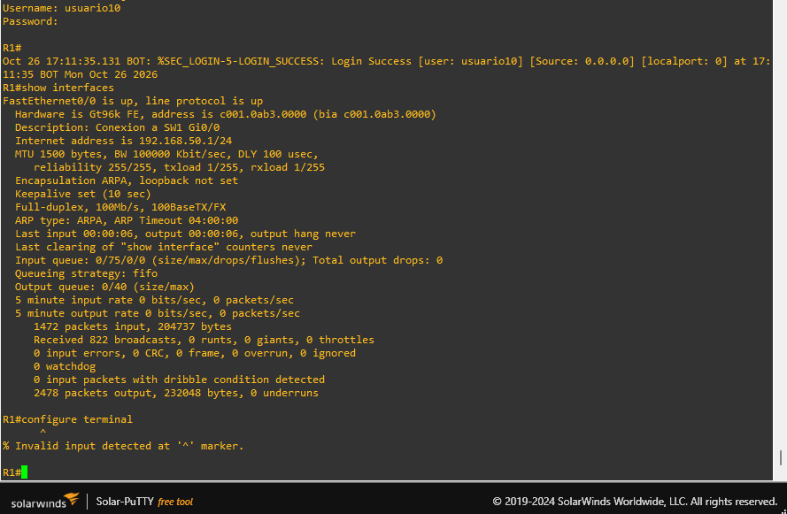

## Privilegios SW1: evidencia historica

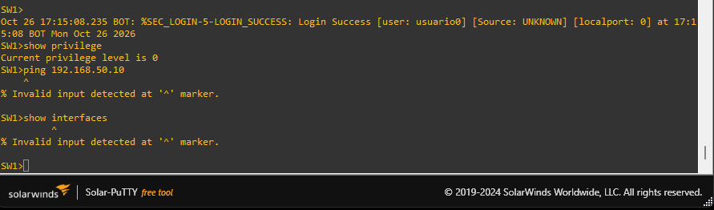
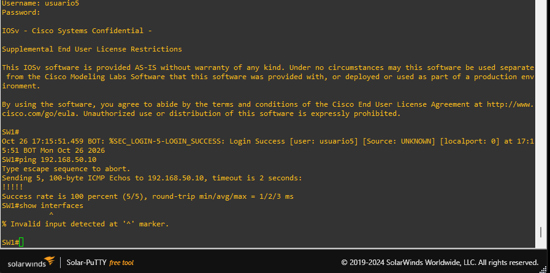
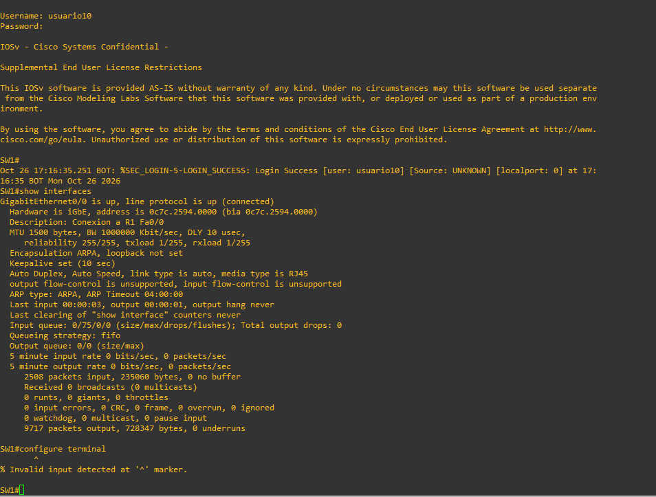

El simbolo # no significa necesariamente nivel 15: las capturas de nivel 5 y 10 tambien lo muestran. Comprobar con show privilege, sin ejecutar enable. En las pruebas se utilizo enable posteriormente solo para administrar y guardar cambios.

## Registros NPS: evidencia historica

Evento 6272: usuario5, cliente SW1, politica Cisco-Nivel5, autenticacion PAP, acceso concedido.

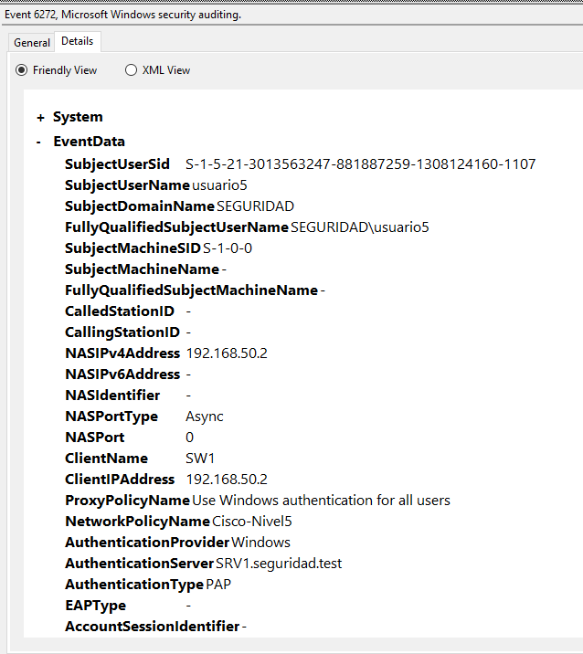

Evento 6273: usuario0, cliente SW1, ReasonCode 16. El mensaje indica discrepancia de credenciales: usuario inexistente o contrasena incorrecta. Este evento acredita rechazo de autenticacion, no una denegacion por privilegios de comando.

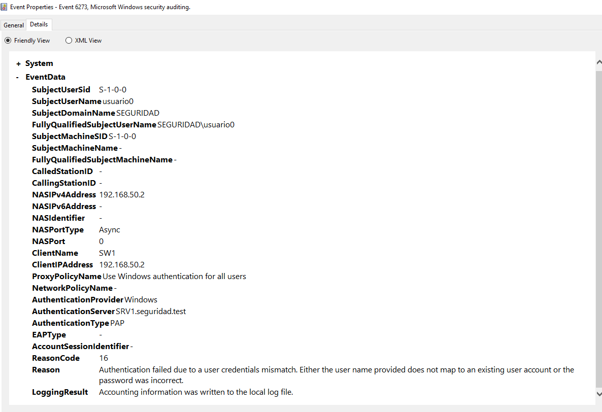

## Autorizacion y RADIUS en IOS

Los registros suministrados de ambos equipos incluyeron:

```text
Access-Accept
Cisco AVpair "shell:priv-lvl=5"
AAA/AUTHOR/EXEC: processing AV priv-lvl=5
AAA/AUTHOR/EXEC: Authorization successful
```

En SW1 tambien se registro Access-Reject para el nombre mal escrito usario5 y LOGIN_FAILED. R1 tenia fecha de 2002 durante la primera captura de depuracion; despues se ajusto su reloj a BOT. Por ello no se presentan esos mensajes antiguos como registros tomados con hora correcta. La depuracion se desactivo al terminar.

## Respaldo local: evidencia historica

Procedimiento realizado: detener IAS, ingresar adminlocal, comprobar nivel 15 y volver a iniciar IAS. Las imagenes complementan el relato del operador, pero no contienen una correlacion horaria completa entre servidor y equipo.

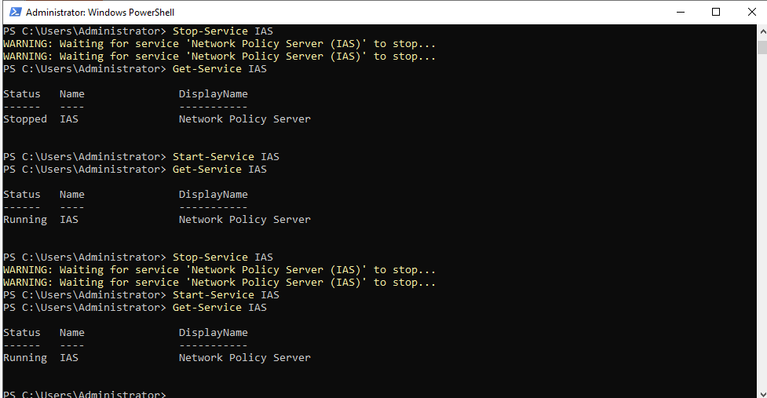
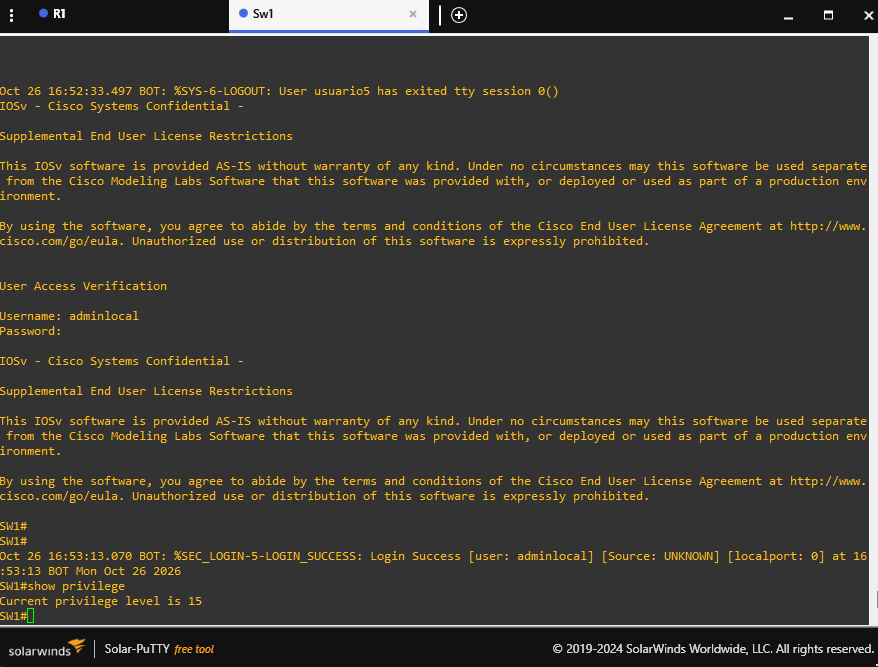
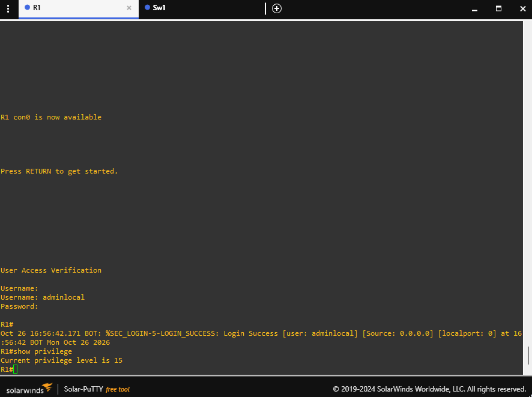

## Lista para repetir en la red final

| Prueba | Resultado esperado |
|---|---|
| R1 y SW1: ping 192.168.88.10 | Respuesta |
| SRV1: Resolve-DnsName SRV1.seguridad.test -Type A | 192.168.88.10, sin registro A antiguo |
| usuario0: show privilege / ping / show interfaces | 0 / bloqueado / bloqueado |
| usuario5: show privilege / ping / show interfaces | 5 / permitido / bloqueado |
| usuario10: show privilege / show interfaces / configure terminal | 10 / permitido / bloqueado |
| Contrasena incorrecta | Rechazo y evento 6273 |
| IAS detenido, adminlocal | Acceso local nivel 15; restaurar IAS |
| show ip ssh | SSH Enabled - version 2.0 |
| show running-config, seccion line | AAA en con y aux, VTY bloqueadas |
| show debugging | Sin depuracion activa |

No se realizo prueba de acceso AUX ni conexion remota SSH. No ejecutar enable durante las pruebas de permisos.
